# Terra - Tesseract Compiler
a fork based on https://github.com/TheTesseractProject/tract

> *Terra* is one of the implementations of the Tesseract language.
> At this time, this implementation may not comply with Tesseract standards.

> [!WARNING]
> This project is currently under active development. Features and documentation may change frequently. At the moment the language is not ready for full-fledged work, it is a prototype.

```tesseract
TesseractClass {
    a: int;
    b: str;
    hi {
         put("Hello there!");
    }
}

Class = TesseractClass.new;
Class.hi;
```

```txt
output:
Hello there!
```


## 🚀 Features

- **Fast Compilation**: Optimized for speed and efficiency
- **Cross-platform**: Works on Linux, macOS, and Windows
- **Modern C**: Written in C23 with best practices
- **Error Handling**: Comprehensive error reporting

## 🧩 Language Notes (current prototype)

- Classes declare fields (`name: type;`) and methods (`name { ... }` or
  `name(args: type) { ... }`).
- `Class.new` allocates a zeroed instance; `Class.init(args)` allocates one and
  calls `init`.
- A field whose type is a user-defined class is a pointer to an instance, so a
  class may reference another class declared later in the same file.
- Methods can be called with or without parentheses (`obj.run;` is `obj.run()`).
- `let name = value;` explicitly declares a variable. Existing assignment syntax
  remains available for updates and backwards compatibility.
- `fn main() { ... }` is the application entry point. A program without it keeps
  script-style top-level execution.
- C-style `for` loops accept declarations, conditions, and assignment steps:
  `for (let i = 0; i < limit; i = i + 1) { ... }`; `break;` and `continue;`
  work inside both `for` and `while` loops.
- Top-level `link "library";` adds a native linker dependency when using
  `--compile` (for example, `link "sqlite3";` becomes `-lsqlite3`).
- Built-ins: `put`, `print`, `len`, `str`, `int`, `float`, `assert`, `input`.
- Native interop: `import "stdio.h"; extern fn printf(format: str, ...): i32;`
  followed by ordinary `printf(...)` calls. Existing `@c.printf(...)` and
  `@math.sqrt(...)` calls remain available.
- C ABI types include `i8`/`u8` through `i64`/`u64`, `usize`, `isize`, `ptr`,
  and explicit aliases such as `c_int` and `c_ulong`. Unknown identifier types
  in an `extern fn` signature are opaque C typedefs; `FILE` maps to `FILE*`.
- Systems features include fixed arrays (`let a: i32[4] = [1, 2, 3, 4];`),
  typed slices (`let view: slice[i32] = a[1:3];`), indexing, pointer types
  (`i32*`), `&` and `*`, C-layout `struct` and `union` declarations with
  aggregate initializers, and `volatile` qualified types.
- `asm("instruction");` and `asm volatile("instruction");` emit GNU-style
  inline assembly templates. Assembly constraints and operands are not yet
  represented by source syntax.

## 📋 Requirements

### Build Dependencies
- **CMake** 3.16 or higher
- **C Compiler**: Clang 18 or higher (recommended) or GCC 15 or higher
- **Build System**: Ninja (recommended) or Make

### Runtime Dependencies
- **POSIX-compliant terminal** (for animation feature)
- **Math library** (linked automatically)

## 🛠️ Building

### Quick Start (Recommended)
```bash
# Clone the repository
git clone https://github.com/nazar-ponomarenko-dots/Terra
cd terra
```

```bash
# Build with Clang and Ninja (recommended)
export CC=clang && export CXX=clang++
cmake -S . -B build -G Ninja
cmake --build build
```

```bash
# Build with GCC
export CC=gcc && export CXX=g++
cmake -S . -B build -G Ninja
cmake --build build
```

```bash
# Run the application
./bin/terra --help
```

### Clean Build
```bash
rm -rf bin/ build/
```

## 🎯 Usage

### Basic Commands

```bash
# Show help
./bin/terra --help

# Show version
./bin/terra --version

# Translate a file to C (writes ./output by default)
./bin/terra input.tt

# Translate with a custom output path
./bin/terra input.tt -o output.c

# Only parse and type-check
./bin/terra --check input.tt

# Write the generated C to stdout
./bin/terra input.tt --stdout

```

> Terra emits C99-style source that uses a few GNU extensions (`__auto_type`,
> statement expressions) for assign-to-declare and `Class.init(...)`. Build the
> result with GCC/Clang in GNU mode, e.g. `cc output.c -o program`.

### Native C headers and libraries

Import a system header directly. `extern fn` gives the call a checked Tesseract
signature and emits a C prototype; the included header lets the C compiler
check that prototype against the library declaration:

```tesseract
import "stdio.h";
extern fn printf(format: str, ...): i32;

let value = 42;
printf("value = %lld\n", value);
```

```sh
./bin/terra examples/c_import.t -o /tmp/c_import.c
cc /tmp/c_import.c -o /tmp/c_import
```

For libraries that need a linker flag, pass it to the C compiler when building
the generated source, for example `cc app.c -lsqlite3 -o app`, or declare it in
the source and use the executable build mode:

```tesseract
import "sqlite3.h" as sqlite;
link "sqlite3";
```

```sh
./bin/terra app.t --compile -o app
```

`--compile` invokes the selected compiler directly, without a shell, and
publishes the executable only after a successful compile. Select another
compiler with `--cc /path/to/cc`. Header names and library names are validated.
Variadic calls follow the C ABI, including C's default argument promotions and
format-string rules.

Cross-compilation passes a target triple to Clang:

```sh
terra app.t --compile --cc clang --target aarch64-unknown-linux-gnu -o app
```

`--freestanding` emits a relocatable object (`terra.o` by default) without a
hosted runtime prelude or system link step. Functions, records, arrays, slices,
pointers, and inline assembly are supported. Hosted built-ins, Terra classes,
and executable top-level statements are rejected in this mode. Startup code,
the linker script, and the platform runtime are supplied when linking:

```sh
terra kernel.t --compile --cc clang --target x86_64-unknown-none-elf \
  --freestanding -o kernel.o
```

An opaque C typedef can be used without exposing its layout:

```tesseract
import "stdio.h";
extern fn fopen(path: str, mode: str): FILE;
extern fn fputs(text: str, stream: FILE): i32;
extern fn fclose(stream: FILE): i32;
```

See [c_file.t](/home/votbotcot/Terra/examples/c_file.t) for a complete example.
File-based Tesseract module imports remain unsupported. The executable build
mode is currently POSIX-only; C source generation remains available on all
supported platforms.

### Command Line Options

| Option | Long Option | Description |
|--------|-------------|-------------|
| `-h` | `--help` | Show help information |
| `-v`, `-V` | `--version` | Show version and build information |
| `-b` | `--build` | Compile the specified file (path may also be positional) |
| `-o` | `--output` | Output path; `-` means stdout (`--output=path` also works) |
| `-c` | `--check` | Parse and type-check only, do not generate C |
| | `--stdout` | Write generated C to standard output |
| | `--compile` | Compile generated C into an executable |
| | `--cc <path>` | Select compiler for `--compile` |
| `-q` | `--quiet` | Suppress progress messages |
| | `--` | Treat all following arguments as paths |

### Supported File Extensions

- `.tt` - Tesseract source files
- `.tes` - Tesseract source files (alternative)
- `.t` - Tesseract source files (alternative)

## 🧪 Development

### Code Style

This project follows the following coding standards:
- **C23 Standard** compliance
- **4-space indentation** (no tabs)
- **Snake_case** for functions and variables
- **UPPER_CASE** for constants and macros
- **Comprehensive error handling**
- **Memory safety** practices

## 🤝 Contributing

1. Fork the repository
2. Create a feature branch (`git checkout -b feature/amazing-feature`)
3. Commit your changes (`git commit -m 'Add amazing feature'`)
4. Push to the branch (`git push origin feature/amazing-feature`)
5. Open a Pull Request

### Development Guidelines

- Follow the existing code style
- Add error handling for all new functions
- Include appropriate documentation
- Test on multiple platforms if possible

## 📄 License

This project is licensed under the terms specified in the [LICENSE](LICENSE) file.

## 🙏 Acknowledgments

- Made with ❤️ by Contributors
- Inspired by the mathematical beauty of 4D tesseracts
- Built with modern C development practices

## 📞 Support

If you encounter any issues or have questions:

1. Check the [Issues](https://github.com/nazar-ponomarenko-dots/Terra/issues) page
2. Create a new issue with detailed information
3. Include your system information and error messages

---

**Terra** - Where mathematics meets performance! 🚀
